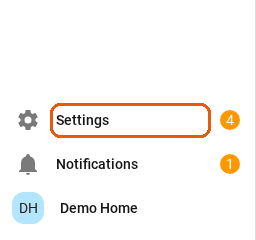
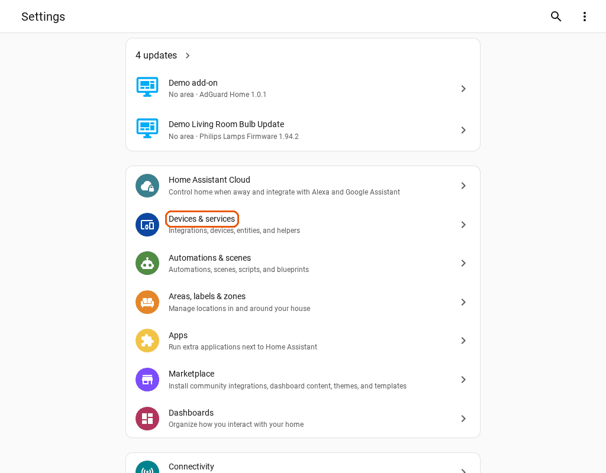
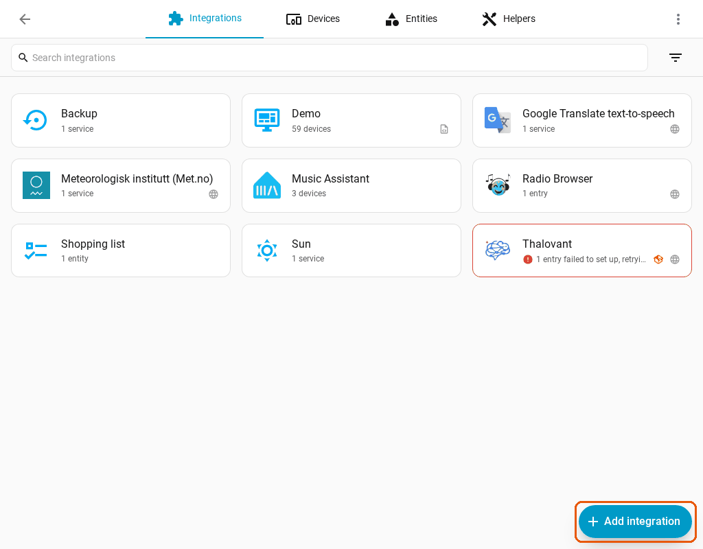
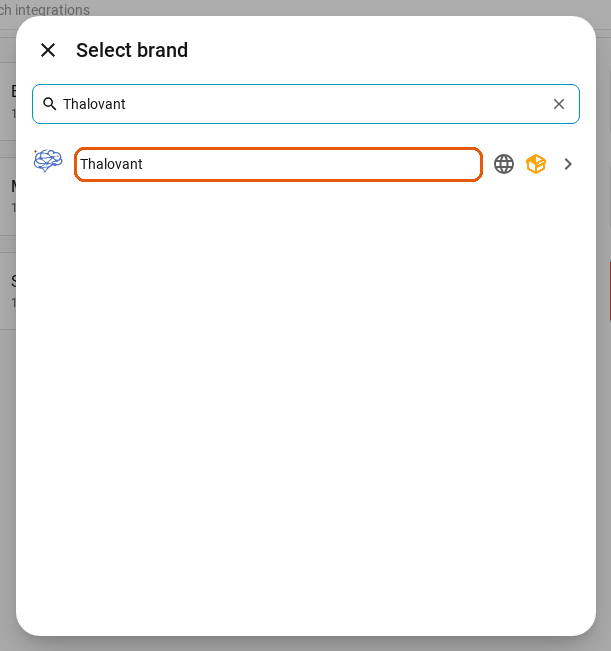
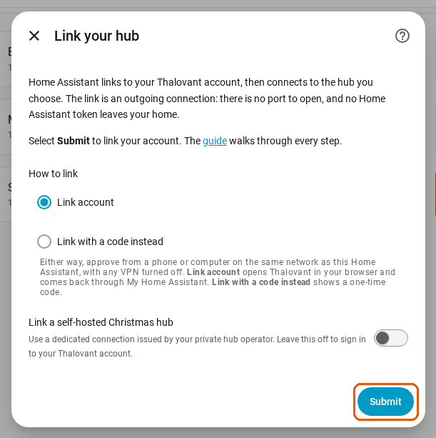
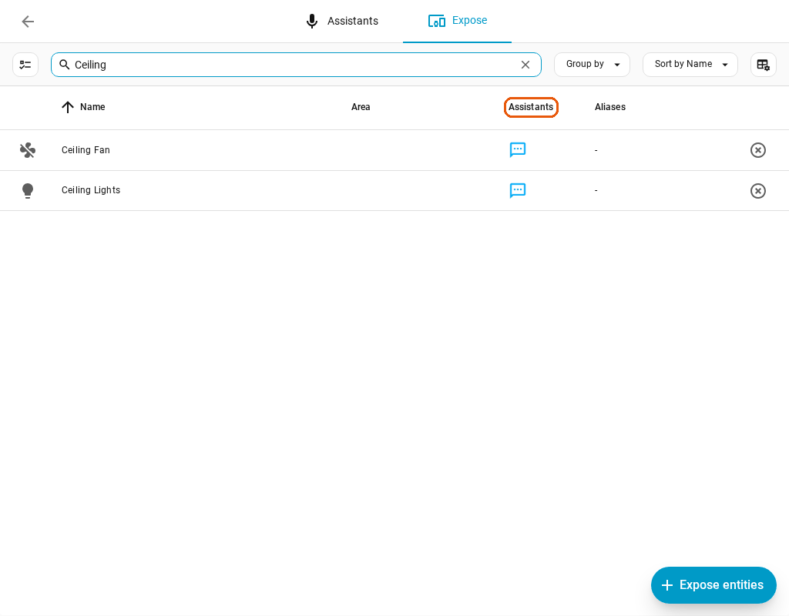
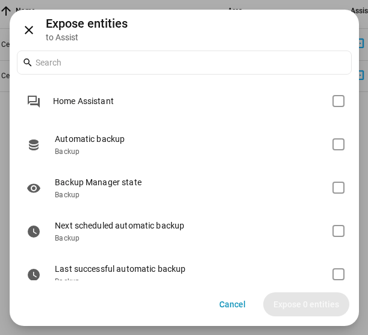

# Connect Home Assistant to Thalovant

Say "turn off the kitchen light" to any Thalovant device, and Home Assistant does it.

**What you need**

- Home Assistant 2026.9 or later, with [HACS](https://hacs.xyz).
- A Thalovant account with one hub.
- A phone or computer on the same network as Home Assistant (home Wi-Fi or cable), with any VPN turned off.

This takes about five minutes, and one of them is waiting. Steps 1, 7, 8 and 9 happen in HACS and on Thalovant's pages, so they are described in words, not pictures.

## Steps

1. **Download Thalovant in HACS.** Open **HACS**, search for **Thalovant**, select **Download**, then restart Home Assistant when HACS asks.

2. **Open Settings.** In the menu on the left, select **Settings**.

   

3. **Select Devices & services.**

   

4. **Select Add integration.** The button is at the bottom right.

   

5. **Search for Thalovant.** Type **Thalovant**, then select the result.

   

6. **Leave Link account selected and select Submit.** A new browser tab opens.

   

7. **Approve the request in the new tab.** Sign in to Thalovant if it asks. Check that the request names **Home Assistant**, then approve it. The tab sends you back to Home Assistant. The first time, a page called My Home Assistant asks for your Home Assistant's address.

8. **Pick your hub.** Home Assistant shows your hubs. Select the one whose devices should control this home.

9. **Wait about a minute and a half.** Home Assistant says when the link is ready.

10. **Choose what Thalovant can control.** Thalovant can only use the devices you let Assist use. Open **Settings**, then **Voice assistants**, then the **Expose** tab. A blue speech bubble in the **Assistants** column means the device is allowed.

    

    To allow more devices, select **Expose entities**, tick them, and select **Expose**.

    

## Check it works

Pick one device from the Expose list in step 10, for example a light called **Ceiling Lights**. Say to a Thalovant device: "Turn on" followed by that device's name, such as "Turn on the ceiling lights." The device switches on, and you hear Home Assistant's own answer, such as "Turned on the light."

## If it doesn't work

- **Home Assistant says "Failed setup, will retry".** The hub is still letting Home Assistant in. Wait two minutes. If it stays, check that the hub is online in your Thalovant account.
- **The approval page refuses.** Open the link on a phone or computer on the same network as Home Assistant, with the VPN off.
- **"I can't find that device".** The device is not exposed. Do step 10 for it, and give the device a room so "in the kitchen" works.

## More

[More options](guide.md) covers choosing another agent, announcements, a code instead of Link account, and removing the link. To play music, see [Play music from Music Assistant](play-music-from-music-assistant.md).
