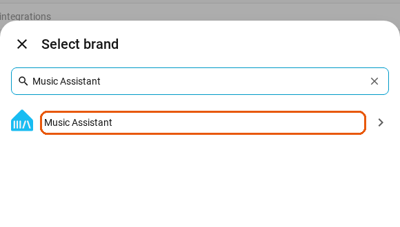
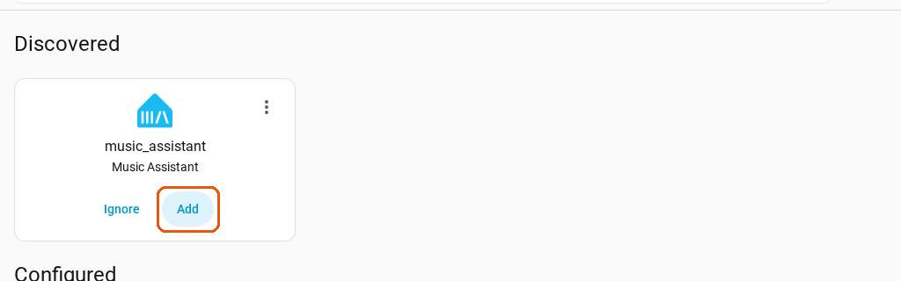
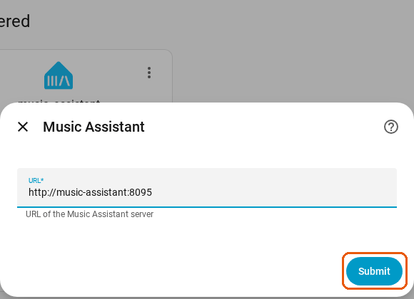
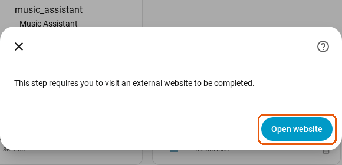
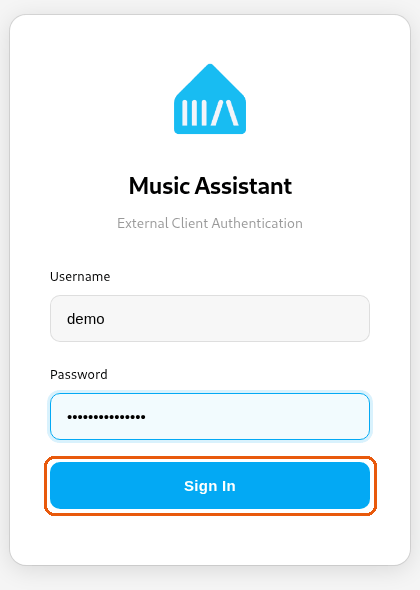
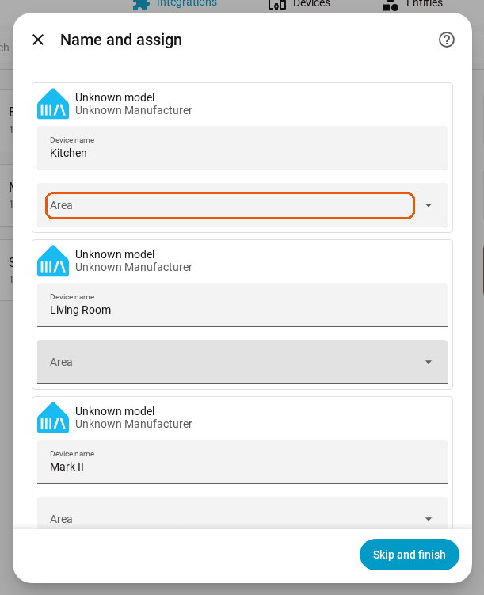
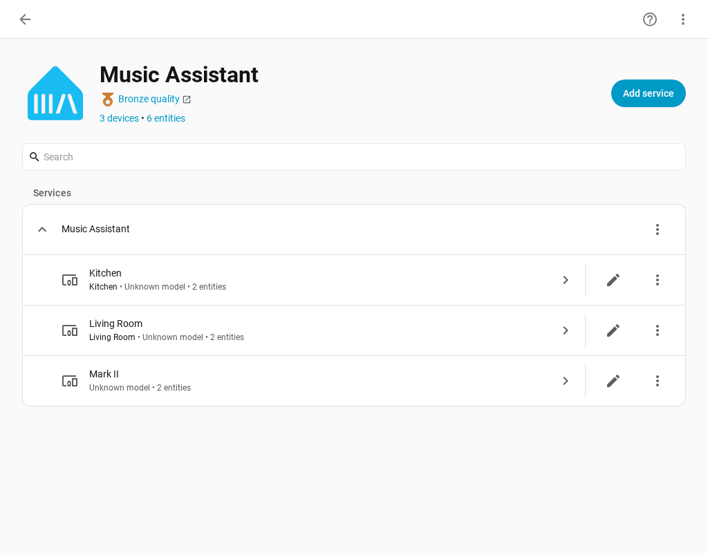
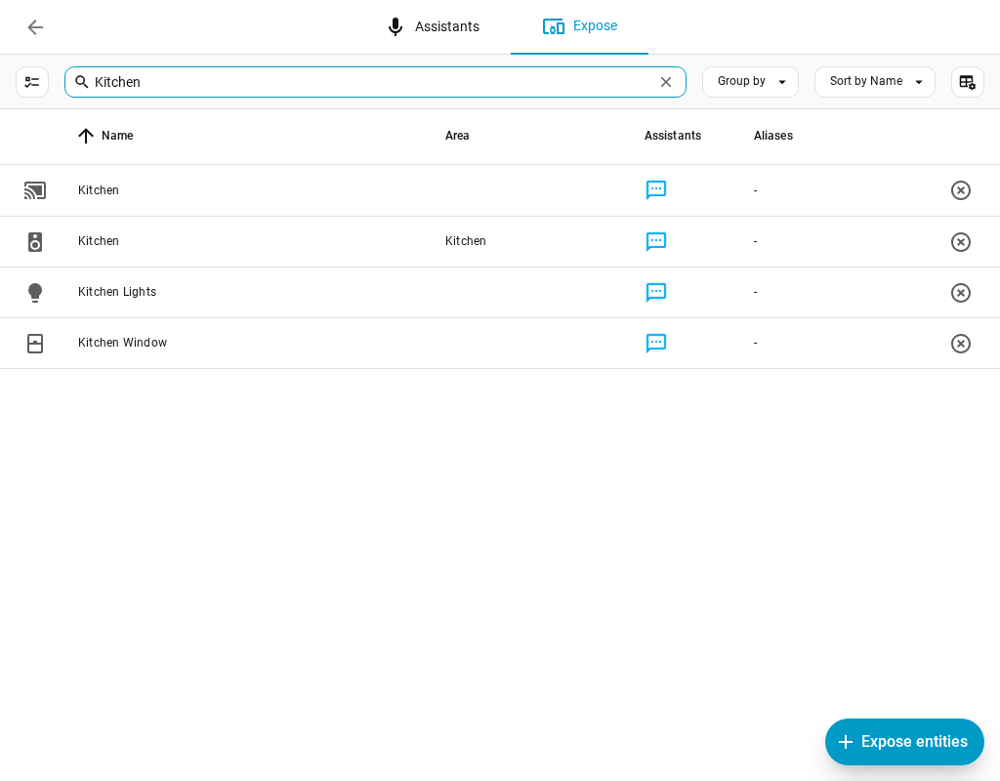
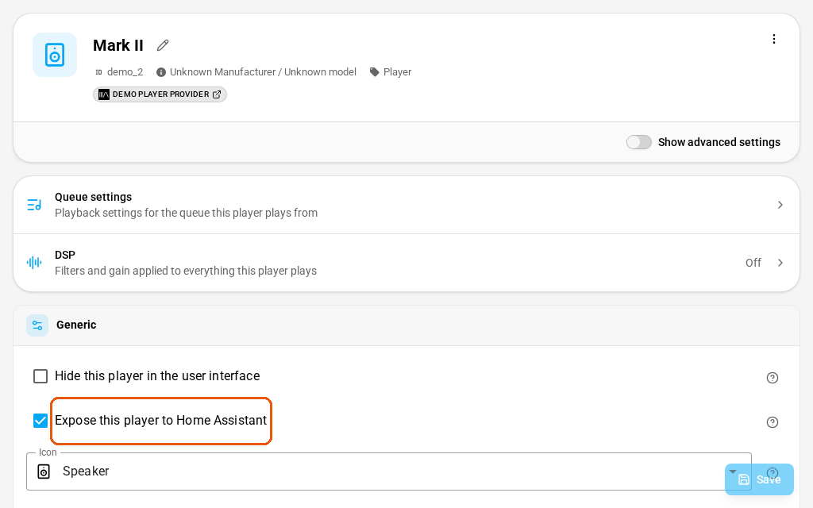

# Play music from Music Assistant through Home Assistant

Say "play Adam's Song in the kitchen" to a Thalovant device, and your Music Assistant plays it on the kitchen speaker. Use the name of a track, album, artist or playlist you have: this route looks names up, so it does not play a whole genre.

**What you need**

- Home Assistant linked to Thalovant ([Connect Home Assistant to Thalovant](connect-home-assistant.md)).
- Music Assistant running at home, with its username and password.
- Your speakers already showing in Music Assistant.

## Steps

1. **Add the integration.** In Home Assistant, go to **Settings**, then **Devices & services**, then **Add integration**. Type **Music Assistant** and select it.

   

2. **If Home Assistant already found your server, use that.** Under **Discovered** you may see **Music Assistant**. Select **Add** and go to step 5.

   

3. **Type your server's address.** Use the address you open Music Assistant at, for example `http://music-assistant:8095`. Select **Submit**.

   

4. **Select Open website.** Music Assistant opens in a new tab.

   

5. **Sign in to Music Assistant.** Use your Music Assistant username and password, then select **Sign In**. The tab sends you back to Home Assistant.

   

6. **Give each speaker a room.** Under **Area**, pick the room each speaker is in, then select **Finish**. This is what makes "in the kitchen" work.

   

   Your speakers now show as devices.

   

7. **Check that Thalovant may use them.** Open **Settings**, **Voice assistants**, **Expose**, and search for the speaker's name. A blue speech bubble means it is allowed. New speakers are allowed by default. If a speaker has no bubble (for example you turned off **Expose new entities**), select **Expose entities**, tick the speaker, and select **Expose**.

   

## Check it works

Say: "Play" and the name of a track you own, then "in the kitchen", such as "Play Adam's Song in the kitchen." You hear the kitchen speaker start, and Thalovant answers with what it queued, such as "Playing Adam's Song by blink-182 on Kitchen."

## If it doesn't work

- **"I couldn't find that in your music".** The title is not in Music Assistant or its services. Try an artist you know is there.
- **"in the kitchen" is not understood.** Open **Settings**, then **Repairs**. "Give Kitchen a room" means the speaker has no Area: open its device and choose one.
- **The wrong speaker plays.** Two devices share a name, for example a Chromecast and a Music Assistant speaker. **Repairs** says "Two devices are called Kitchen", and when you name it, Thalovant says it used the Music Assistant one. Rename the other in Home Assistant.
- **A speaker is missing.** In Music Assistant, open the player's settings and tick **Expose this player to Home Assistant**.

   

## More

How the music requests travel, and what each one can do, is in [Music through Home Assistant](music.md). To play music without Home Assistant, use the [Music Assistant bridge](https://github.com/thalovant/thalovant-music-bridge/blob/main/docs/connect-music-assistant.md).
